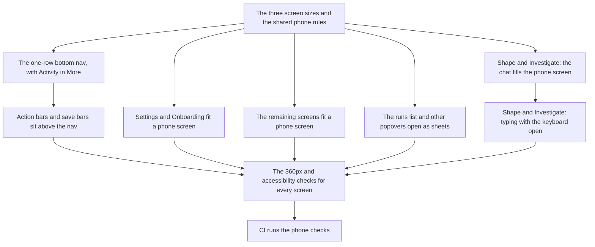

# Tasks — Compass phone layout rules

Epic: genai-jerry/software-factory-view#178. One task is one pull request,
half a day or less. All tasks land in **software-factory-view** — this epic
touches no other repo. The home branch is `main`: this repo has no staging
branch, so task branches cut from `main` and task PRs base on it.

Order: the shared style rules land first, every screen task builds on them,
and the checks land last so they go green against screens that already fit.
Every intermediate merge leaves the app releasable — screens get better one
at a time, and nothing red is ever merged.

## Task order

| Lands | Task | Waits on |
|---|---|---|
| 1st | The three screen sizes and the shared phone rules | — |
| 2nd | The one-row bottom nav, with Activity in More | The shared phone rules |
| 3rd | Action bars and save bars sit above the nav | The one-row bottom nav |
| 3rd (parallel) | Settings and Onboarding fit a phone screen | The shared phone rules |
| 3rd (parallel) | The remaining screens fit a phone screen | The shared phone rules |
| 3rd (parallel) | The runs list and other popovers open as sheets | The shared phone rules |
| 3rd (parallel) | Shape and Investigate: the chat fills the phone screen | The shared phone rules |
| 4th | Shape and Investigate: typing with the keyboard open | The chat fills the phone screen |
| 5th | The 360px and accessibility checks for every screen | Every screen task above |
| last | CI runs the phone checks | The checks themselves |

## Task 1 — The three screen sizes and the shared phone rules

**Repo:** software-factory-view. **Depends on:** nothing.
**Status:** done (#180).

Give the whole app one set of screen sizes and one set of phone rules, in
`apps/web/src/styles.css`, for every later task to build on:

- Three screen sizes only: phone under 768px, tablet 768–1023px, desktop
  1024px and up. Today the stylesheet switches at 640, 720, 768, 860, 900 and
  1024px; fold those odd widths into the three sizes without changing how any
  screen looks at the common test widths (360, 768, 1280).
- A shared rule that content too wide for the screen wraps, or scrolls inside
  its own box — the page itself never scrolls sideways and never cuts
  content off.
- A shared rule that controls are at least 44 by 44 pixels on phones.

This task changes the rules, not the screens: a screen that breaks a rule
today is fixed by its own task below.

**Spec scenarios served:** groundwork for *Every route checked* and
*Removing an attached image* (the 44px rule); every other task leans on it.

## Task 2 — The one-row bottom nav, with Activity in More

**Repo:** software-factory-view. **Depends on:** Task 1.

On screens narrower than 1024px the bottom nav shows exactly five items in
one row: Work, Decisions, Shape, Investigate, More. Activity moves into the
More sheet. Today `apps/web/src/components/Shell.tsx` puts six items in a
four-column grid, so the nav wraps to two rows. The nav must stay one row at
every width under 1024px, not just at 360px.

**Spec scenarios served:** *Nav on a phone*.

## Task 3 — Action bars and save bars sit above the nav

**Repo:** software-factory-view. **Depends on:** Task 2.

Every sticky bar — the action bar on gate screens (`ActionBar`), the halt
bar, the update bar, and the save bar in Settings — sits fully above the
bottom nav and never covers it. The nav's one-row height from Task 2 is what
these bars stack on, which is why this waits for it.

**Spec scenarios served:** *Settings save bar on a phone*.

## Task 4 — Settings and Onboarding fit a phone screen

**Repo:** software-factory-view. **Depends on:** Task 1.

At 360px wide, Settings (`apps/web/src/pages/Settings.tsx`) and Onboarding
(`Onboarding.tsx`) fit the screen: rows wrap instead of being cut off, and
each repository name and time on a Settings row is fully visible. No
sideways page scroll on either screen.

**Spec scenarios served:** *Settings rows on a phone*; part of *Every route
checked*.

## Task 5 — The remaining screens fit a phone screen

**Repo:** software-factory-view. **Depends on:** Task 1.

At 360px wide, every other screen fits: the epic workspace
(`EpicWorkspace.tsx`), Tools, Models, Environments, the run page
(`OrchestratorRun.tsx`), and the issue peek (`IssuePeek.tsx`). Wide content —
run logs, tables, long names — wraps or scrolls inside its own box using the
Task 1 rules. No screen scrolls the page sideways.

**Spec scenarios served:** *Every route checked*.

## Task 6 — The runs list and other popovers open as sheets

**Repo:** software-factory-view. **Depends on:** Task 1.

On phones, the runs list opened from the header (`RunsBadge.tsx`) opens as a
sheet that stays fully on screen, using the existing `Sheet` component.
Check the other popovers and drawers the app opens and give any that can
leave the screen the same treatment.

**Spec scenarios served:** *Runs popover on a phone*.

## Task 7 — Shape and Investigate: the chat fills the phone screen

**Repo:** software-factory-view. **Depends on:** Task 1.

On phones, Shape and Investigate (`apps/web/src/pages/Shape.tsx`) show the
chat full screen. The conversation list moves behind a "Conversations"
button that opens it as a sheet. On tablet and desktop the list stays beside
the chat as today.

**Spec scenarios served:** *Finding past conversations*.

## Task 8 — Shape and Investigate: typing with the keyboard open

**Repo:** software-factory-view. **Depends on:** Task 7.

In the same screens, when a person focuses the composer at 360px and the
phone keyboard opens, the composer and the latest message stay visible. The
button that removes an attached image becomes at least 44 by 44 pixels.
Waits on Task 7 because both tasks rework the same screen.

**Spec scenarios served:** *Typing a message on a phone*; *Removing an
attached image*.

## Task 9 — The 360px and accessibility checks for every screen

**Repo:** software-factory-view. **Depends on:** Tasks 3, 4, 5, 6 and 8 (every screen task).

Extend the phone tests in `apps/web/e2e/` so that every route the app
defines gets, at 360px: a no-sideways-scroll check, and an accessibility
(axe) check. Add checks that the bottom nav is one row of five items and
that the sticky bars do not cover it. The checks run against the e2e harness
and must pass — which is why this lands after every screen is fixed. A
failing check names the route that failed.

**Spec scenarios served:** *Every route checked*; the checks themselves
assert *Nav on a phone*, *Settings save bar on a phone*, *Settings rows on a
phone*, *Runs popover on a phone*, *Removing an attached image* and
*Finding past conversations*.

## Task 10 — CI runs the phone checks

**Repo:** software-factory-view. **Depends on:** Task 9.

The pull-request check job (in `.github/workflows/deploy.yml`) runs the
phone checks from Task 9 on every pull request, and the build fails when a
check fails, naming the route. Install the browsers the checks need in that
job. Keep the job's time reasonable — the checks run at 360px only in CI if
running all three widths is too slow.

**Spec scenarios served:** *A screen stops fitting*; *Phone checks enforced
in CI*.

## Scenario coverage

Every spec scenario is served by at least one task:

| Spec scenario | Task(s) |
|---|---|
| Nav on a phone | Task 2 (asserted by Task 9) |
| Settings save bar on a phone | Task 3 (asserted by Task 9) |
| Settings rows on a phone | Task 4 (asserted by Task 9) |
| Every route checked | Tasks 1, 4, 5, 9 |
| Runs popover on a phone | Task 6 (asserted by Task 9) |
| Removing an attached image | Tasks 1, 8 (asserted by Task 9) |
| Typing a message on a phone | Task 8 |
| Finding past conversations | Task 7 (asserted by Task 9) |
| A screen stops fitting | Tasks 9, 10 |
